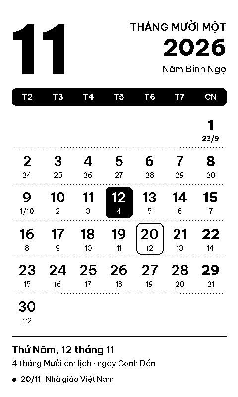

# Lịch Âm Dương – plugin CrossPoint

Màn hình ngủ là lịch tháng tiếng Việt có âm lịch. Phỏng theo
[Month Wallpaper](https://github.com/marczykm/month-wallpaper-crosspoint-plugin)
của marczykm, nhưng không cần máy chủ: GitHub Actions vẽ ảnh mỗi ngày và đẩy
lên nhánh `wallpaper`, máy đọc tải thẳng từ đó.

- Plugin cài lên máy: [`lich-am.crosspoint-plugin/`](lich-am.crosspoint-plugin/)
- Bộ vẽ: `python tools/render.py [--date YYYY-MM-DD] [--out out]` (cần `pip install pillow`)

## Đưa lên GitHub

1. Tạo repo công khai tên `lich-am-crosspoint-plugin`, đẩy mã lên nhánh `main`.
   Workflow `wallpaper` sẽ chạy và tạo nhánh `wallpaper` chứa `current.bmp`.
2. Để Plugin Hub tự nhận: gắn topic `crosspoint-plugin` và tạo Release có tag
   trùng `version` trong manifest (`1.0.0`).

Phông chữ Be Vietnam Pro, giấy phép OFL (`tools/fonts/OFL.txt`).
